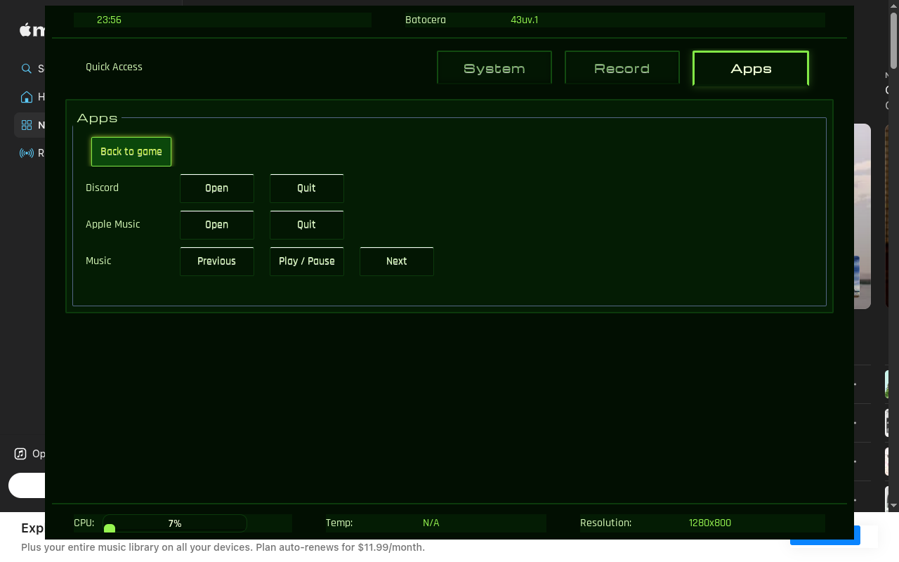

# RetroBox

A console-style setup for [Batocera](https://batocera.org): an Xbox-style look, Discord and Apple
Music you can drive with a controller, a few quality-of-life settings, and an installer that also
puts your own BIOS files and games on the drive.



Everything goes into Batocera's data folder (`/userdata`, the `SHARE` partition), the part
Batocera's updates leave alone. Nothing in Batocera itself is changed, and anything installed can
be taken off again.

## Install

**From a Linux PC**, with the Batocera drive plugged in and opened in the file manager:

```sh
git clone https://github.com/Konfus-dev/RetroBox
cd RetroBox
./install
```

**On Batocera itself** (over SSH, or from a terminal):

```sh
cd /userdata/system
curl -L https://github.com/Konfus-dev/RetroBox/archive/HEAD.tar.gz | tar xz
RetroBox-*/install
```

The installer finds the drive and asks what you want:

```
Install the Xbox-style look (green theme, menu colours, fonts and sounds)? [Y/n]
Install Apple Music (the web player, set up for the controller)? [Y/n]
Install Discord (voice and text chat, set up for the controller)? [Y/n]
...
Install BIOS files? [y/N] y
  Where are they? A repository address or a folder: https://github.com/you/your-bios
Systems in this library:
   1) PlayStation (7 files, 4 MB)
   2) PlayStation 2 (18 files, 36 MB)
Which ones? Numbers like 1,3-5, or Enter for all:
```

It shows a summary and asks once more before changing anything. Run it again any time to add
things or update; it only copies what is missing.

| Command | Does |
| --- | --- |
| `./install` | ask about everything |
| `./install --list` | show what can be installed, and what is |
| `./install --remove discord` | take something off again |
| `./install --yes --with look,discord --games /mnt/games` | no questions (for scripts) |
| `./backup-games ~/my-games` | copy the games on a drive into a library folder |

## What you can install

| | |
| --- | --- |
| **Xbox-style look** | Theme for the menus, matching colours for the in-game menu, fonts, sounds |
| **Discord**, **Apple Music** | Open from Ports, or over a running game from the in-game menu's **Apps** tab. Each downloads itself the first time you open it |
| **ROM-hack patcher** | Drop a `.ips`/`.bps`/`.ups` file in `patches` and it is applied at boot |
| **Play settings** | Auto-save, rewind on 8/16-bit systems, a light CRT shader, a tidier network share |
| **Bluetooth controllers** | Offered when preparing a drive on a PC with paired controllers: copies the pairings so the same controller works in Linux and Batocera without re-pairing |
| **Wi-Fi** | Asks for the network name and password, so Batocera connects by itself |
| **ScreenScraper account** | For box art, videos and descriptions; with the picture style and extras already chosen |
| **RetroAchievements account** | Trophies for older games |
| **Game stores** | Adds the Steam and Heroic (Epic, GOG) installer to Ports |
| **OMEN lights** | Only offered on an HP OMEN PC that has the lights; fetched from [its own repository](https://github.com/Konfus-dev/OmenRGB-Controller) |

### Controller buttons in the apps

| Button | Does |
| --- | --- |
| D-pad | Move |
| A / B | Select / back |
| Right stick, R3 | Pointer, click |
| Left stick | Scroll |
| L3 | On-screen keyboard |
| Guide, or Select+A | In-game menu |
| Select+B | Hide the app and go back to the game (it keeps running) |
| Select+Start | Quit the app |

Each app adds its own on top (see its `app.json`): in Discord, X mutes, Y searches, LB/RB step
through items, LT/RT switch servers; in Apple Music, X or Start plays and pauses, LB/RB change
song, LT/RT change the volume, Y opens the keyboard.

In the in-game menu's **Apps** tab each app has one box: Open and Quit, and for a player what is
playing with Previous, Play/Pause and Next.

## Your BIOS files and games

These are yours, so they are not in this repository. Keep each in a **library**: a folder with one
sub-folder per system, named as Batocera names them.

```
my-games/                      my-bios/
  psx/Some Game (USA).chd        psx/scph5501.bin
  psx/images/...                 ps2/ps2/SCPH-70012.bin     (as it sits in Batocera's bios folder)
  snes/Another Game.sfc          segacd/bios_CD_U.bin
```

A library can be a folder on a drive or NAS, or a private git repository; the installer takes
either. Multi-disc games count as one game. For games, another Batocera drive works as a library
too. `./backup-games` makes a games library from a drive, with a `MANIFEST.tsv` of checksums and a
`.gitignore` for the files too large for GitHub (those stay in the folder only).

On Batocera itself there is no `git`: public GitHub repositories download directly, private ones
need an access token (`https://TOKEN@github.com/you/repo`) or use a folder on a USB drive.

## How it is put together

```
install, backup-games    what you run
installer/               the installer (plain Python, nothing to install)
apps/<name>/             one app: app.json (what to start, controller buttons) and tile.png
components/<name>/       everything else: component.json says what to copy and switch on
components/console/      the console tools every app shares: launcher, controller mapper, keyboard, menu tab
tools/                   commands for looking after a drive from a Linux PC (see its README); dev/ for development
tests/                   python3 -m unittest discover tests
```

Adding an app or a tweak means adding a folder; the installer picks it up and asks about it.
See [docs/extending.md](docs/extending.md).

## Good to know

- Batocera runs everything as the administrator, and the apps run without the browser sandbox, as
  Chromium-based programs must there. Treat the drive as a games machine, not a place for
  sensitive browsing.
- Controller buttons are read by their Xbox-pad labels.
- Log on Batocera: `/userdata/system/logs/retrobox.log` (`RETROBOX_DEBUG=1` logs every button).

Licence: GPL-3.0-or-later. Fonts: SIL Open Font Licence (see `components/look/files/fonts`).
RetroBox is not affiliated with Microsoft, Discord or Apple; it ships none of their artwork or software.
