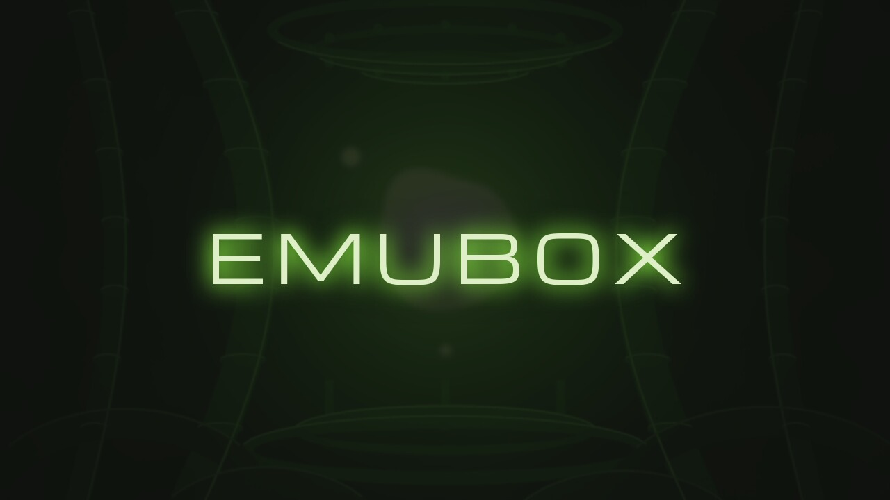
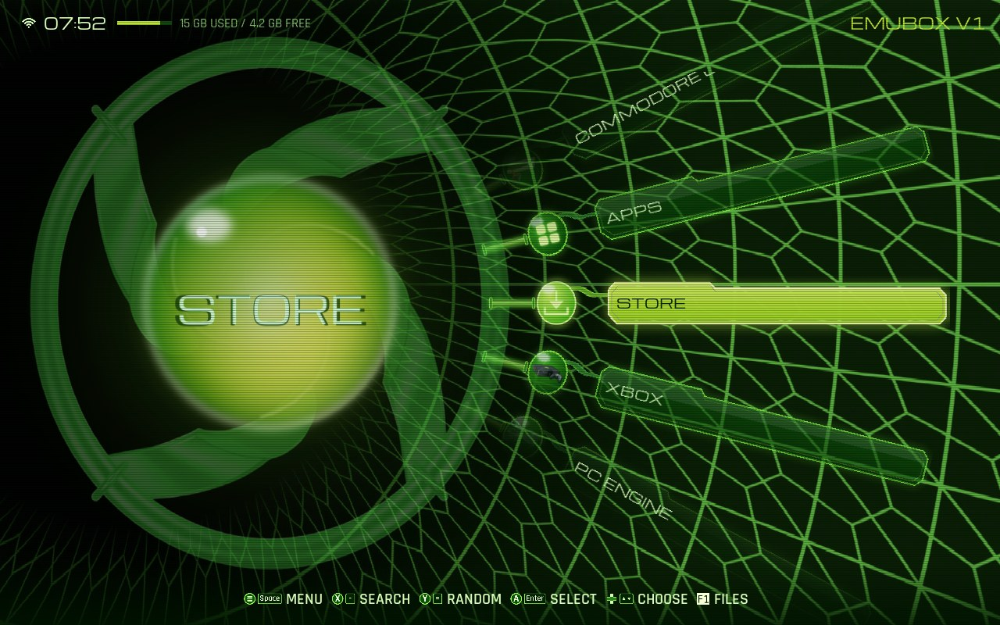
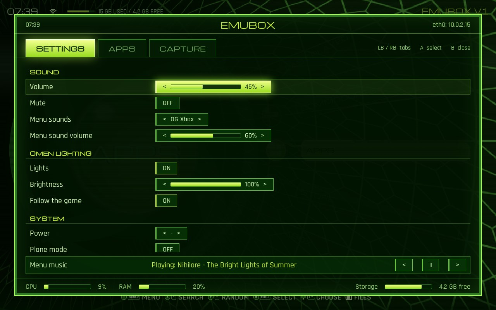

# EmuBox

EmuBox turns a [Batocera](https://batocera.org) drive into something that feels like one console:
a green dashboard look with its own start-up film, apps you drive with the controller (Discord,
Apple Music, a web store browser), a quick menu on the Guide button, and an installer that also
puts your own BIOS files, games and menu sounds on the drive.

| | | |
| --- | --- | --- |
|  |  |  |
| Starting up | Home | The Guide menu |

Everything goes into Batocera's data folder (the `SHARE` partition), which Batocera's updates
leave alone. Nothing in Batocera itself is changed, and anything installed can be taken off again.

## Install

From a Linux PC, with the Batocera drive plugged in:

```sh
git clone https://github.com/Konfus-dev/EmuBox
cd EmuBox
./install
```

Or on Batocera itself (over SSH, or from a terminal):

```sh
cd /userdata/system
curl -L https://github.com/Konfus-dev/EmuBox/archive/HEAD.tar.gz | tar xz
EmuBox-*/install
```

The installer finds the drive, asks what you want, shows a summary and asks once more before
changing anything. Run it again any time to add things or update. `./install --list` shows what
there is; `./install --remove <name>` takes something off.

## What you get

- **The look**: the theme, a start-up film, glass-pane menus, and one row of indicators along the
  top (controllers, free space, clock, network).
- **Apps**, a section of their own on the home screen: Discord and Apple Music, set up for the
  controller and already downloaded onto the drive, plus a Terminal, Files, and Claude Code.
- **Store**: games (free games, Steam, Heroic, itch.io and **Vault**, your own list of store
  pages whose downloads go straight into your games, [more](docs/vault.md)) and apps (add
  YouTube, Twitch, Netflix and others, or anything from Flathub).
- **The Guide menu**: quick settings, your apps, and bars along the bottom for a call or the
  music that is playing, each with its controls.
- **Settings** in Batocera's own menu: Start > Game Settings > EmuBox (menu sounds, apps, and the
  lights on an HP OMEN PC).
- **Menu sounds and music**: sounds for moving, choosing and going back, with your own sound sets
  if you bring some, and menu music you can skip and pause.
- **Extras**: a ROM-hack patcher, sensible play settings, Wi-Fi and account set-up, Bluetooth
  controllers shared with the PC.

## More

- [Everything in detail](docs/details.md): each option, the buttons, BIOS and games libraries, sound sets, troubleshooting
- [Vault](docs/vault.md) · [Adding your own apps and components](docs/extending.md) · [Helper commands for the PC](tools/README.md)

EmuBox is not affiliated with Microsoft, Discord or Apple; it ships none of their artwork or software.
A tile's icon is the app's own: taken from the program once it is on the drive, or asked of Flathub or
the app's site when you install. Without a network the tiles keep EmuBox's own drawings.
